# Dreams pipeline

The Dreams pipeline calls the [Claude Dreams API][dreams] from
three independent call sites in the platform, each for background
reflection over a different kind of historical signal:

1. **Memory summary** — polishes monthly memory summaries instead
   of the default Haiku call.
2. **Skill distillation** — groups N similar CU trajectories into
   a cohort, asks Dreams to produce a polished `SkillCandidate`
   body.
3. **Plan templates** — groups N similar successful planner
   decompositions into a cohort, asks Dreams to produce a polished
   `LearnedPlanTemplate`.

The three call sites share a structural mechanism — cohort grouping
by bag-of-tokens cosine similarity, anchor clustering with a
minimum cohort size, mechanical fallback for cohorts below the
floor — but live in three different crates so the persistence and
trait surfaces stay local to each subsystem. There is no
standalone `argo-dreams` crate.

[dreams]: https://platform.claude.com/docs/en/managed-agents/dreams

```mermaid
graph TD
    subgraph "Memory summary (argo-memory::dreams_backend)"
        MemRows[MemoryEntry rows<br/>≤100 sessions / namespace] --> AnomMem{anomaly_guard:<br/>worker has open<br/>anomaly events?}
        AnomMem -->|yes| SkipM[skip — don't dream]
        AnomMem -->|no| CapMem{DailyCapTracker:<br/>spend < cap?}
        CapMem -->|no| SkipM2[skip — over cap]
        CapMem -->|yes| MemCall[DreamsCaller::dream<br/>HTTP POST to ANTHROPIC_DREAMS_URL]
        MemCall --> MemResult[DreamResult<br/>summary + cost_micros + model]
        MemResult --> MemPersist[append to MemoryStore<br/>layer=Summary, kind=dream_summary,<br/>source=dreams_api]
    end

    subgraph "Skill distillation (argo-skill::dreams_distillation)"
        Traj[CU trajectories<br/>TrajectoryInput rows] --> Group1[group_into_cohorts<br/>by vertical_id + action_type<br/>cosine ≥ 0.7]
        Group1 --> Floor1{cohort size<br/>≥ MIN_COHORT_SIZE = 3?}
        Floor1 -->|no| MechS[mechanical fallback:<br/>SkillCandidate::from_cu_trajectory]
        Floor1 -->|yes| SkillCall[DreamsSkillCaller::distill<br/>HTTP from argo-cli skill_distill_now]
        SkillCall --> Cand[SkillCandidate<br/>body_source = dreams_distilled]
        Cand --> SkillPersist[SkillStore::propose_for_review<br/>pending review]
    end

    subgraph "Plan templates (argo-runtime::dreams_plan_templates)"
        Hist[Planner decompositions<br/>PlanCohortInput rows from subtask_ledger] --> Group2[group_into_plan_cohorts<br/>by parent_goal cosine ≥ 0.7]
        Group2 --> Floor2{cohort size<br/>≥ MIN_PLAN_COHORT_SIZE = 3?}
        Floor2 -->|no| MechP[mechanical fallback:<br/>existing TemplatePlanner defaults]
        Floor2 -->|yes| PlanCall[DreamsPlanCaller::distill<br/>HTTP from argo-cli plan layer]
        PlanCall --> Templ[LearnedPlanTemplate<br/>status = Pending]
        Templ --> PlanPersist[argo_store::learned_plan_template<br/>TrustGrade ladder: Pending → Promoted]
    end
```

## Shared mechanism

All three pipelines use the same structural pattern:

| Concept | Memory | Skill | Plan |
|---|---|---|---|
| Module | `argo_memory::dreams_backend` | `argo_skill::dreams_distillation` | `argo_runtime::dreams_plan_templates` |
| Caller trait | `DreamsCaller::dream` | `DreamsSkillCaller::distill` | `DreamsPlanCaller::distill` |
| HTTP impl lives in | `argo-cli` (env-backed) | `argo-cli` (`skill_distill_now`) | `argo-cli` (plan layer) |
| Cohort gate | N/A (per-namespace) | `MIN_COHORT_SIZE = 3`, cosine `≥ 0.7` | `MIN_PLAN_COHORT_SIZE = 3`, cosine `≥ 0.7` |
| Fallback when below floor | Legacy Haiku summary | `SkillCandidate::from_cu_trajectory` | Existing `TemplatePlanner` defaults |
| Marker constant | `DEFAULT_COST_USD_MICROS = 750_000` | `BODY_SOURCE_DREAMS = "dreams_distilled"` | `BODY_SOURCE_DREAMS = "dreams_distilled"` |
| Persistence | `MemoryStore::append` (Summary layer) | `SkillStore::propose_for_review` | `argo_store::learned_plan_template::insert` |

Each crate keeps its own caller trait so the pipeline module stays
free of database / HTTP deps; the production HTTP impl lives in
`argo-cli` where the store and env config are already wired.

## Guardrails

Three guards apply across the pipelines:

1. **Anomaly guard (memory only)** — `anomaly_guard.rs` blocks a
   dream for any worker with open anomaly events. A misbehaving
   worker would otherwise poison its own dream.
2. **Daily cap (memory)** — `DailyCapTracker` enforces a per-worker
   USD cap (default $5, overridable via
   `ARGO_DREAMS_DAILY_CAP_USD_MICROS`). Skill and plan distillation
   inherit their own caps from the calling handler in `argo-cli`.
3. **Cohort floor (skill + plan)** — cohorts below the minimum size
   never call Dreams; the legacy mechanical paths still fire on
   isolated successes so behavior degrades cleanly when input
   volume is low.

## Non-destructive

Dreams results are always written as new rows. The original memory
rows, trajectories, and planner decompositions are unchanged — a
bad dream can be ignored or overridden without rollback. For skill
and plan templates, the row enters the TrustGrade ladder at
`Pending` and an operator promotes it; nothing replaces the
shipped-default templates implicitly.

## On-demand entry points

- `argo memory dream-now <worker>` — runs a memory dream
  immediately (see `argo-cli/src/handlers/memory_dream_now.rs`).
- `argo skill distill-now` — runs the skill distillation pipeline
  over recent CU trajectories.
- `argo plan template promote` — promotes a `Pending`
  `LearnedPlanTemplate` to active use.

## See also

- `crates/argo-memory/src/dreams_backend.rs` — memory summary
  Dreams backend (feature-gated under `dreams-backend`).
- `crates/argo-skill/src/dreams_distillation.rs` — skill
  distillation pipeline + cohort grouping.
- `crates/argo-runtime/src/dreams_plan_templates.rs` — plan
  template Dreams pipeline + `LearnedPlanTemplate`.
- `crates/argo-cli/src/handlers/memory_dream_now.rs` — operator
  on-demand entry for memory dreams.
- `crates/argo-cli/src/handlers/` — search for `skill_distill_now`
  and the plan distillation handler for the HTTP transport and
  daily-cap accounting layer.
