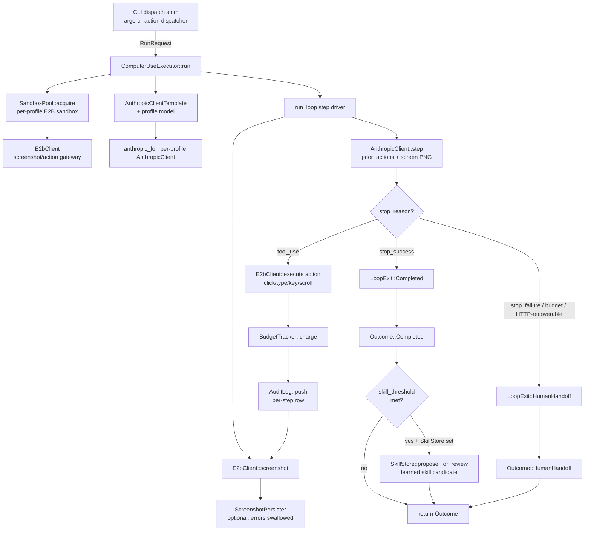

# Executor dispatch

`ComputerUseExecutor` is the computer-use action runner: it
orchestrates an Anthropic model step loop against an E2B sandbox
session, with a per-action USD budget, an audit log, and optional
screenshot persistence and skill-learning hooks.

A dispatch starts with a `RunRequest` (action id, tenant, persona,
profile, system prompt, optional budget) and ends with an
`Outcome::Completed { result, bundle_dir, budget }` or
`Outcome::HumanHandoff { reason, bundle_dir, budget }`. Outcome
polarity matters: `Completed` auto-completes the action ledger row
with the embedded `result_json`; `HumanHandoff` leaves the row at
`executing` and the operator finishes it manually.

## Side channels

The executor uses three pluggable side channels. Each is `Option`-shaped
so a missing dependency degrades cleanly to "best-effort":

- **`SkillStore`** — when set, a successful run whose metric clears
  `skill_threshold` proposes a `SkillCandidate` for human review. A
  learning-loop failure never fails the action; errors are logged
  and swallowed.
- **`ScreenshotPersister`** — when set, every step's screenshot is
  pushed through the persister so replay can fetch historical
  shots after the sandbox recycles. Persister errors are logged +
  swallowed so a flaky blob backend never fails an in-progress
  action.
- **`BudgetTracker`** — required (not optional). Per-action USD cap
  sourced from `RunRequest::budget_usd` or the manifest's
  `executor.budget_usd` field. The tracker emits `BudgetVerdict`
  values per step; an exhausted budget triggers
  `LoopExit::HumanHandoff` with a budget-exhausted reason.

## Restart and recoverable failures

If `AnthropicClient::step` returns a recoverable HTTP error, the
loop delegates to `handle_restart` on the per-profile
`RestartCoordinator`. That helper may:

- Re-acquire a fresh sandbox from the pool (the prior one may be
  bad).
- Re-take the screenshot.
- Re-feed `prior_actions` and resume from the next step.

If the coordinator exhausts its retries, the loop returns
`LoopExit::HumanHandoff` with the original error in the reason
string. Sandbox prewarming is handled by `sandbox_prewarm.rs` and
the `e2b_reap_cron` periodically drops stale sandboxes — both
operate orthogonally to a single dispatch.

## See also

- `crates/argo-executor-computer-use/src/executor.rs` —
  `ComputerUseExecutor` orchestrator.
- `crates/argo-executor-computer-use/src/executor_types.rs` —
  `RunRequest`, `RunResult`, `Outcome`.
- `crates/argo-executor-computer-use/src/executor_step_helpers.rs`
  — `run_loop`, the per-step Anthropic ↔ E2B driver.
- `crates/argo-executor-computer-use/src/executor_loop_exit.rs` —
  `LoopExit` polarity + restart handling.
- `crates/argo-executor-computer-use/src/anthropic.rs` —
  `AnthropicClient` step request / response shapes.
- `crates/argo-executor-computer-use/src/e2b.rs` — `E2bClient`,
  `E2bSandbox`, screenshot + action APIs.
- `crates/argo-executor-computer-use/src/budget.rs`,
  `audit.rs`, `pool.rs`, `profile.rs`, `screenshot_persist.rs`,
  `restart.rs`, `sandbox_prewarm.rs`, `e2b_reap.rs` — side
  channels and lifecycle helpers.
- `crates/argo-executor-computer-use/src/learn.rs` — skill-learning
  hook that proposes `SkillCandidate`s after successful runs.
