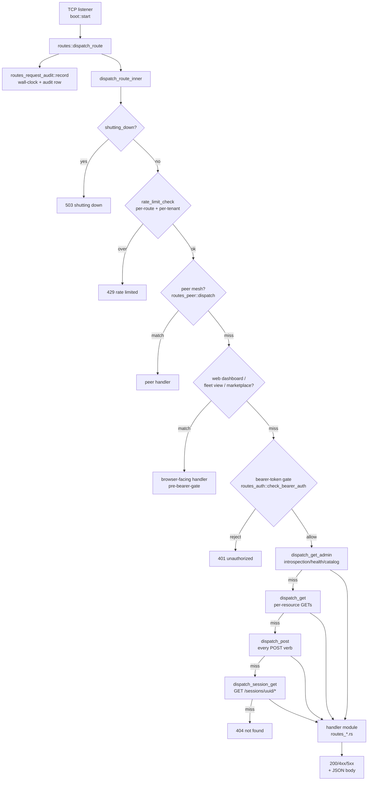

# Gateway routes

The `argo gateway` HTTP listener is a single TCP loop in
`crates/argo-cli/src/handlers/gateway/`. Every accepted connection
is parsed into a `(method path …)` request line and fed to
`routes::dispatch_route`, which walks an ordered chain of
sub-dispatchers and returns `(status_line, body)`. There is no
external HTTP framework — the routing is a series of `if
req.starts_with(...)` matches across ~120 `routes_*.rs` modules,
split that way to honor the 500-LOC per-file invariant.

The diagram below traces a request from the listener through the
ordered guard chain (shutdown drain, rate limits, peer mesh, web
dashboard, bearer-token gate) and into the per-method routers
(`dispatch_get_admin`, `dispatch_get`, `dispatch_post`,
`dispatch_session_get`). Each router fans out to per-resource
handler modules that compose the response.

## Route groups (where to look)

The router files are organized by resource group. The dispatchers
above route into these:

| Group | Files | What they cover |
|---|---|---|
| Admin / introspection | `routes_dispatch_get_admin.rs`, `routes_meta*.rs`, `routes_health.rs`, `routes_top.rs` | `/`, `/version`, `/health{,/live,/ready,/full}`, `/readyz`, `/livez`, `/doctor`, `/routes`, `/audit/recent`, `/search`, `/db/*`, `/metrics/json` |
| Sessions | `routes_session*.rs`, `routes_dispatch_get.rs` (for list GETs) | `/sessions`, `/sessions/<uuid>/{messages,skills,judge,spend,export,clone,approval,stats}` |
| Audit | `routes_audit*.rs` | `/audit{,/recent,/breaks,/count,/stream,/feed}`, `/audit/sessions/<id>`, `/audit/screenshots/*`, `/audit/rollups[/tools]` |
| Channels | `routes_channels*.rs` | `/channels/{slack,discord,email,whatsapp,imessage,push,voice,webinbox}` |
| Skills | `routes_skills*.rs`, `routes_skill_refine.rs`, `routes_session_skills*.rs` | `/skills`, `/skills/<name>`, `/skills/quality`, skill refine + lifecycle |
| Memory | `routes_lists_memory.rs`, `routes_dispatch_post_memory.rs` | `/memory/*`, memory write endpoints |
| Forge | `routes_forge*.rs` | `/forge`, `/forge/runs[/<id>]`, `/forge/promote`, `/forge/rollups` |
| Dashboards (browser) | `routes_dashboard.rs`, `dashboard_fleet.rs`, `marketplace.rs` | `/dashboard/*`, `/fleet`, `/marketplace/*` — mounted ahead of the bearer gate so a browser works without per-tab tokens |
| Workers / verticals | `routes_workers_hire.rs`, `routes_worker_*.rs`, `routes_verticals*.rs`, `routes_team_list.rs` | `/workers/*`, `/verticals/*` |
| Peer mesh | `routes_peer.rs` | `/peer/*` — carries its own `ARGO_PEER_SECRET` gate distinct from the operator bearer token |
| Costs / rollups | `routes_costs_by_day.rs`, `routes_dispatch_costs.rs`, `routes_dispatch_rollups.rs`, `routes_sessions_rollups.rs`, `routes_messages_rollups*.rs` | `/costs/*`, `/rollups/*`, `/sessions/rollups`, `/messages/rollups[/recent]` |

The live catalog with every endpoint, method, and parameter is
served by the gateway itself at `GET /routes` (or
`argo gateway routes --json` for the same data offline). Treat the
table above as the navigation map, not the catalog.

## Why the chain is ordered

The order of sub-dispatchers in `dispatch_route_inner` is
load-bearing:

1. **Shutdown drain** runs first so SIGTERM mid-flight cleanly
   returns 503 without touching the store.
2. **Per-route rate limiter** runs before bearer auth so spam from
   anonymous browsers can be capped without spending CPU on token
   validation.
3. **Peer mesh** runs before the operator bearer gate because
   `/peer/*` carries its own `ARGO_PEER_SECRET` and would otherwise
   need to know both tokens.
4. **Web dashboard / fleet / marketplace** mount before the bearer
   gate so a browser session works without provisioning per-tab
   tokens; mutating actions still go through `/inbox/approve|reject`
   with their own operator-token check.
5. **Bearer-token gate** stops every non-allowlisted GET that isn't
   `/`, `/health[/...]`, `/version`, or `/routes` — those four stay
   anonymous so liveness probes, load balancers, and catalog
   discovery keep working.

## See also

- `crates/argo-cli/src/handlers/gateway/routes.rs` — the dispatcher
  entry point.
- `crates/argo-cli/src/handlers/gateway/routes_dispatch_get_admin.rs`,
  `routes_dispatch_get.rs`, `routes_dispatch_post.rs`,
  `routes_session_get.rs` — per-method routers.
- `crates/argo-cli/src/handlers/gateway/routes_request_audit.rs` —
  audit-chain row appended per request.
- `crates/argo-cli/src/handlers/gateway/rate_limit*.rs` — token
  buckets per route and per tenant.
- `crates/argo-cli/src/handlers/gateway/shutdown.rs` — drain
  coordinator + 503 body.
- `crates/argo-cli/src/handlers/gateway/print_routes.rs` — printer
  behind `argo gateway routes`.
