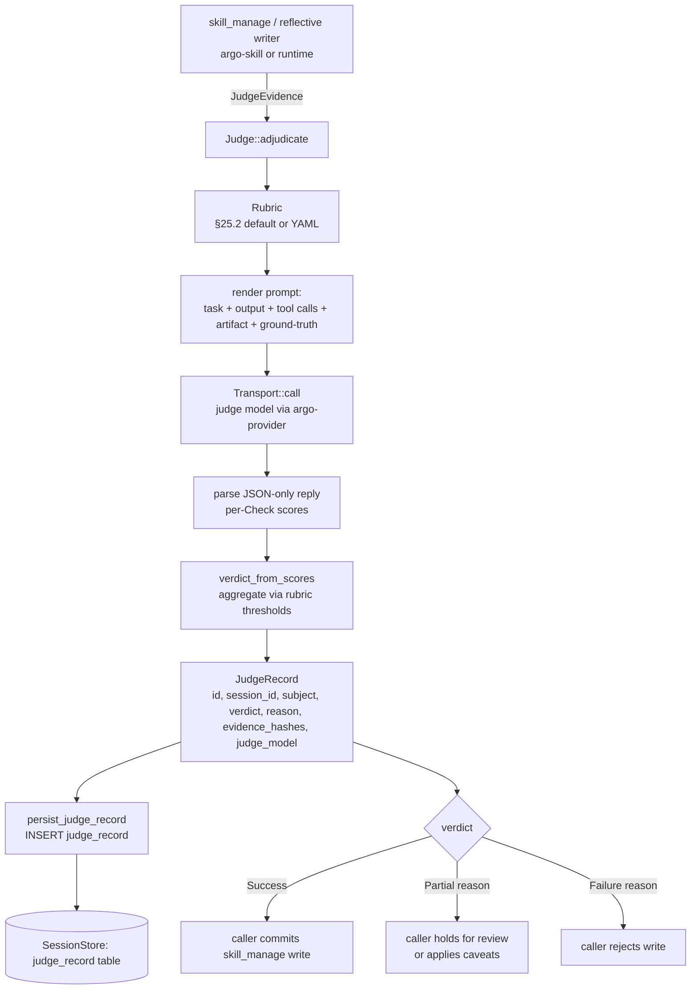

# Judge integration

`argo-judge` is the external-LLM adjudication seam for reflective
state changes — primarily skill creation and skill refinement
(§14.3 + §25). Every reflective write flows through
`Judge::adjudicate` before the downstream `skill_manage` commit
runs. The judge scores the proposed artifact against a `Rubric`
using `JudgeEvidence`, returns a three-state `JudgeVerdict`, and
persists a `JudgeRecord` to the audit chain.

## What flows in: `JudgeEvidence`

`JudgeEvidence` is the snapshot the judge needs to score a write:

- **`task`** — the task statement (what the agent was asked to do).
- **`agent_output`** — what the agent emitted (e.g. the natural-language
  trajectory or the rendered skill body).
- **`tool_calls`** + **`tool_results`** — the call/result pairs that
  preceded the artifact, for cross-checking grounding.
- **`proposed_artifact`** — the thing being judged
  (`ProposedArtifact::SkillCreate { name, body, hash }` /
  `SkillRefine { name, from_version, to_version, body_diff, body_hash }`).
- **`ground_truth_checks`** — optional pre-computed pass/fail signals
  (e.g. "does this skill body compile?", "does the YAML parse?").

The evidence is hashed before the call (`evidence_hashes`) so the
persisted `JudgeRecord` can be replayed against the same input
without re-storing the entire blob.

## What flows out: `JudgeVerdict`

`JudgeVerdict` is three-state:

| Variant | Meaning | Downstream effect |
|---|---|---|
| `Success` | All required checks passed at-or-above the rubric's `success` threshold | Caller proceeds with the write |
| `Partial { reason }` | At-or-above `partial`, below `success` | Caller may proceed with caveats, or queue for human review |
| `Failure { reason }` | Below `partial` | Caller rejects the write |

The thresholds are encoded in the rubric (`VerdictThresholds`); the
default rubric (§25.2) ships in `rubric.rs::Rubric::default_rubric`.

## Persistence: `judge_record`

`persist_judge_record` writes one row per adjudication to the
`judge_record` table (§7 schema):

| Column | Source |
|---|---|
| `id` | `JudgeRecordId` (UUID v4) |
| `session_id` | Passed in by the caller |
| `subject_kind` | `skill_create` / `skill_refine` / future `memory_write` / `delegate_outcome` |
| `subject_ref` | e.g. `"skill_name@<hex hash>"` |
| `verdict` | `success` / `partial` / `failure` |
| `reason` | Verdict reason (NULL on Success) |
| `judge_provider`, `judge_model` | From `record.judge_model` |
| `rubric_id`, `rubric_version` | From the rubric used |
| `evidence_hashes` | JSON array of hex-encoded SHA-256 hashes |
| `created_at` | Micros since epoch |

Rows are append-only; rubric and judge model are recorded per-row
so a later replay can detect drift if the rubric changes.

## Disagreement evaluation

`eval_suite.rs` provides the harness for measuring judge agreement
against a labeled fixtures directory (`DEFAULT_FIXTURES_DIR`).
`run_disagreement_eval` returns a `DisagreementReport` with a
per-verdict-bucket breakdown and a list of `CaseMismatch` rows for
manual triage. This is how the §25 rubric is tuned without
regressing existing skills.

## See also

- `crates/argo-judge/src/lib.rs` — public API + spec pointers.
- `crates/argo-judge/src/judge.rs` — `Judge` trait, `LlmJudge`,
  `verdict_from_scores`.
- `crates/argo-judge/src/rubric.rs` — `Rubric`, `Check`,
  `VerdictThresholds`, `Rubric::default_rubric`.
- `crates/argo-judge/src/evidence.rs` — `JudgeEvidence`,
  `ProposedArtifact`, `GroundTruthCheck`.
- `crates/argo-judge/src/persist.rs` — `persist_judge_record`,
  `judge_record` column mapping.
- `crates/argo-judge/src/eval_suite.rs` — fixture-driven
  disagreement evaluator.
- The persistence call site for skill writes lives in `argo-skill`;
  for the gateway-side wiring see
  `crates/argo-cli/src/handlers/gateway/routes_post_judge.rs`.
