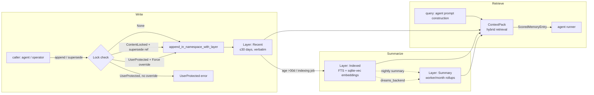

# Memory layers

`MemoryStore` is a content-addressed, append-only store over the
`memory_entry` and `memory_lock` tables in `argo-store`. Every
write produces a new `MemoryEntry`; updates supersede the prior
entry via `superseded_by`, so reverting is a forward operation
(write a new entry pointing at the previous body). There are four
canonical files — `MEMORY.md`, `USER.md`, `SOUL.md`, `AGENTS.md` —
each tracked independently.

Memory rows are partitioned across three storage layers based on
age and indexing state. The Dreams summary pipeline writes into the
`Summary` layer; everything else flows through `Recent` and
`Indexed`.

## Layers

| Layer | Purpose | Storage | When written |
|---|---|---|---|
| `Recent` | Hot, verbatim rows from the last ~30 days | `memory_entry.layer = 'recent'` | Default on every `append` / `supersede` |
| `Indexed` | Older rows with FTS + sqlite-vec embeddings for hybrid retrieval | `memory_entry.layer = 'indexed'` | Background indexing job promotes from `Recent` |
| `Summary` | Worker / month summaries (mechanical or Dreams-generated) | `memory_entry.layer = 'summary'` | `summary.rs` (Haiku) or `dreams_backend` (Dreams API, feature-gated) |

The layer enum lives in `crates/argo-memory/src/layers.rs::MemoryLayer`.

## Locks

`memory_lock` rows gate writes. Three states:

- **`Lock::None`** — agent may freely edit.
- **`Lock::UserProtected`** — agent edits rejected with
  `ArgoError::UserProtected`. Only an explicit
  `PrincipalOverride::Force` writes.
- **`Lock::ContentLocked`** — agent may edit, but the new entry
  must reference the previous entry's id via `supersede`. Used to
  prevent accidental clobbers when two callers race.

Locks survive supersession — a `UserProtected` lock applies to the
file, not the row, so the next agent attempt is still rejected.

## Hybrid retrieval

`ContextPack` (`context.rs`) is the read-side primitive used by the
agent runner. It pulls:

1. **All `Recent` rows** for the requested namespace, verbatim.
2. **Top-K `Indexed` rows** by combined FTS BM25 + cosine over
   `embedding` vectors (Voyage-3 by default, swappable via the
   `EmbeddingProvider` trait).
3. **Latest `Summary` row** per `(worker, month)` covering the
   relevant window.

The hybrid scorer lives in `layers_indexing.rs`. `ScoredMemoryEntry`
carries the combined score so callers can re-rank if needed.

## Namespaces

Multi-tenancy is enforced by `MemoryNs` (`argo-identity`). Every
read and write threads a `MemoryNs` of
`tenant + workspace + worker`. `shared_team` is a separate
namespace tier for cross-worker shared rows within a team — its
own table, but the same lock and supersession semantics.

## Dreams (Summary layer)

When the `dreams-backend` feature is enabled, `dreams_backend.rs`
replaces the default Haiku-based summary path with a Claude Dreams
API call. The result lands in the `Summary` layer with
`kind = 'dream_summary'` and `source = 'dreams_api'`. The legacy
summary path remains the default. Two guards apply: an
[`anomaly_guard`] check (don't dream for a worker with open anomaly
events) and a per-worker daily cap (default $5, overridable via
`ARGO_DREAMS_DAILY_CAP_USD_MICROS`). See
[Dreams pipeline](./dreams-pipeline.md) for the full flow.

## See also

- `crates/argo-memory/src/lib.rs` — public API + canonical files /
  lock semantics.
- `crates/argo-memory/src/store.rs` — `MemoryStore` async wrapper.
- `crates/argo-memory/src/layers.rs` — `MemoryLayer` enum, write
  helpers, `LayeredMemoryEntry`.
- `crates/argo-memory/src/layers_indexing.rs` — schema bootstrap,
  embedding refresh, hybrid scoring.
- `crates/argo-memory/src/context.rs` — `ContextPack` builder.
- `crates/argo-memory/src/entry.rs` — `MemoryEntry`, `MemoryFile`,
  `PrincipalOverride`.
- `crates/argo-memory/src/embedding.rs` — `EmbeddingProvider`,
  Voyage-3 backend.
- `crates/argo-memory/src/dreams_backend.rs` — Dreams API-backed
  summary path (feature-gated).
- `crates/argo-memory/src/shared_team.rs` — cross-worker namespace
  tier.
- See also [Memory and skills](../memory-and-skills.md) for the
  per-file conventions and the skills overlay.
