# 00 — System overview

**Snapshot SHA:** `ed1ac928` (origin/main 2026-05-16)
**Update when:** new top-level crate is added, or a major component is moved/renamed.

Single-page bird's-eye view of the SKYCOT runtime. Boxes are crates (or crate clusters); arrows are runtime dependency / data flow.

## Diagram

```mermaid
flowchart TB
    subgraph EXT[External]
        OP[Operator / End user]
        SLACK[Slack / Email / SMS / Voice]
        LLM[LLM providers<br/>Anthropic · OpenAI · Bedrock]
        MCP_EXT[External MCP servers]
    end

    subgraph WEB[Customer-facing surface]
        MARKETING[marketing/<br/>skycot.com<br/>Next.js]
        SPA[web/<br/>app.skycot.com<br/>Next.js + Radix + Tailwind v4]
    end

    subgraph GW[Gateway · argo-cli/handlers/gateway/]
        AUTH[auth_magic_link<br/>SSO/OIDC/SAML]
        ROUTES[~80 HTTP routes<br/>dashboard · marketplace · audit ·<br/>billing · onboarding · approvals]
        WS_INBOX[ws_inbox_events<br/>per-tenant broadcast]
    end

    subgraph CORE[Core runtime]
        AR[argo-agent-runner<br/>turn loop · dispatch · spend gate]
        ORCH[argo-orchestrator<br/>duty scheduler · handoff · roster]
        GENESIS[argo-genesis<br/>plain-English → vertical]
        TOOL[argo-tool<br/>15 in-core tools]
        SKILL[argo-skill<br/>library · learning cron · IR]
    end

    subgraph EXECS[Action executors]
        CU_MAC[computer-use-macos<br/>v1 primary]
        CU_E2B[computer-use<br/>E2B sandbox]
        DOC_EXEC[document<br/>PDF/CSV/GSuite]
        FS_EXEC[filesystem]
        MCP_RUNTIME[mcp connectors<br/>37 of them]
    end

    subgraph STATE[State & policy]
        STORE[(argo-store<br/>SQLite · 73 migrations)]
        AUDIT[argo-audit<br/>hash-chained]
        IDENTITY[argo-identity<br/>tenant · roster · policy]
        CAP[argo-capability<br/>RBAC gates]
        CHANS[argo-channels<br/>Slack · email · SMS · voice]
        PROV[argo-provider<br/>transport + spend gate]
        MEM[argo-memory<br/>per-worker + team]
        VERT[argo-vertical<br/>manifests + workflows]
    end

    subgraph OBS[Observability]
        TEL[argo-telemetry<br/>Prometheus]
        SIEM[argo-siem]
        FORGE[argo-forge<br/>self-improvement]
        EVAL[argo-eval<br/>regression detection]
    end

    OP --> MARKETING
    OP --> SPA
    SPA --> ROUTES
    SPA --> WS_INBOX
    SLACK --> CHANS
    CHANS --> ROUTES
    
    ROUTES --> AR
    ROUTES --> ORCH
    ROUTES --> GENESIS
    ROUTES --> STORE
    ROUTES --> AUDIT
    
    AR --> TOOL
    AR --> PROV
    AR --> MEM
    AR --> SKILL
    AR --> AUDIT
    AR --> CAP
    
    PROV --> LLM
    TOOL --> EXECS
    EXECS --> MCP_EXT
    MCP_RUNTIME --> MCP_EXT
    
    ORCH --> STORE
    GENESIS --> VERT
    SKILL --> STORE
    AR --> ORCH
    
    AUDIT --> STORE
    IDENTITY --> STORE
    CAP --> IDENTITY
    VERT --> STORE
    MEM --> STORE
    
    AR --> TEL
    GW --> TEL
    AUDIT --> SIEM
    AR --> FORGE
    SKILL --> EVAL

    classDef ext fill:#fff7ed,stroke:#c2410c
    classDef web fill:#eff6ff,stroke:#1d4ed8
    classDef gw fill:#fdf4ff,stroke:#a21caf
    classDef core fill:#f0fdf4,stroke:#16a34a
    classDef exec fill:#fefce8,stroke:#ca8a04
    classDef state fill:#fafaf9,stroke:#525252
    classDef obs fill:#f5f3ff,stroke:#7c3aed

    class EXT ext
    class WEB web
    class GW gw
    class CORE core
    class EXECS exec
    class STATE state
    class OBS obs
```

## Notes

- **Single binary.** Everything in CORE, GW, STATE, OBS compiles to one `argo` binary; deployed via Fly.io to `api.skycot.com`.
- **MCP-first.** Only 15 tools in core (`argo-tool::tools`); everything else (37 connectors) is MCP — subprocesses spawned via `argo-mcp` pool.
- **Multi-tenant.** Every arrow that crosses a tenant boundary plumbs `TenantId`. See `20-multi-tenant-data-flow.md`.
- **Audit chain.** Every action emits an audit row chained via SHA-256. See `21-audit-chain.md`.
- **Top 5 crates by LOC:** `argo-cli` 162k · `argo-store` 34k · `argo-skill` 18k · `argo-tui` 9.5k · `argo-orchestrator` 9.1k.

## Source-of-truth pointers

- Mission claims: `docs/skycot/MISSION.md:26`
- Invariants: `CLAUDE.md:42`
- v1 ship gate: `docs/skycot/V1_DEFINITION.md:5`
