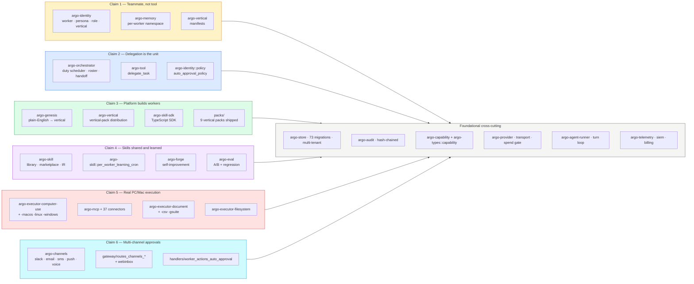

# 01 — Mission claim → crate map

**Snapshot SHA:** `ed1ac928` (origin/main 2026-05-16)
**Update when:** a mission claim is added/removed/reworded, or ownership of a claim shifts crates.

Maps SKYCOT's 6 mission claims to the crates that deliver them. Useful when reasoning about which code path serves which user-visible promise.

## Diagram

## Claim coverage snapshot (per 2026-05-16 codex audit)

| Claim | Verdict | Key gaps closed this weekend |
|---|---|---|
| 1 — Teammate | PARTIAL → mostly DELIVERED | F-03 memory tools now bound to worker/team namespace (#1737) |
| 2 — Delegation | PARTIAL → mostly DELIVERED | F-06 policy-as-code enforcement with real tenant/role/roster (#1742) |
| 3 — Platform builds workers | PARTIAL | Onboarding wizard (#1748) — first hire via plain English |
| 4 — Skills shared and learned | DELIVERED | F-04 learning cron now runtime-spawned from boot (#1736); F-11 trust-aware library selector (in flight) |
| 5 — Real PC/Mac execution | PARTIAL | F-01 macOS CU autonomous loop (#1722) shipped; F-10 smoke now real (#1733) |
| 6 — Multi-channel approvals | PARTIAL | F-05 fallback risk filter (#1738); F-07 voice channel wiring (in flight) |

## Source-of-truth pointers

- Mission claim verbatim: `docs/skycot/MISSION.md:26`
- Per-claim acceptance: `docs/skycot/V1_DEFINITION.md:41`
- Codex audit per-claim verdict: `docs/skycot/audit/2026-05-16-one-shot-architecture-audit.md` §"Coverage by mission claim"
