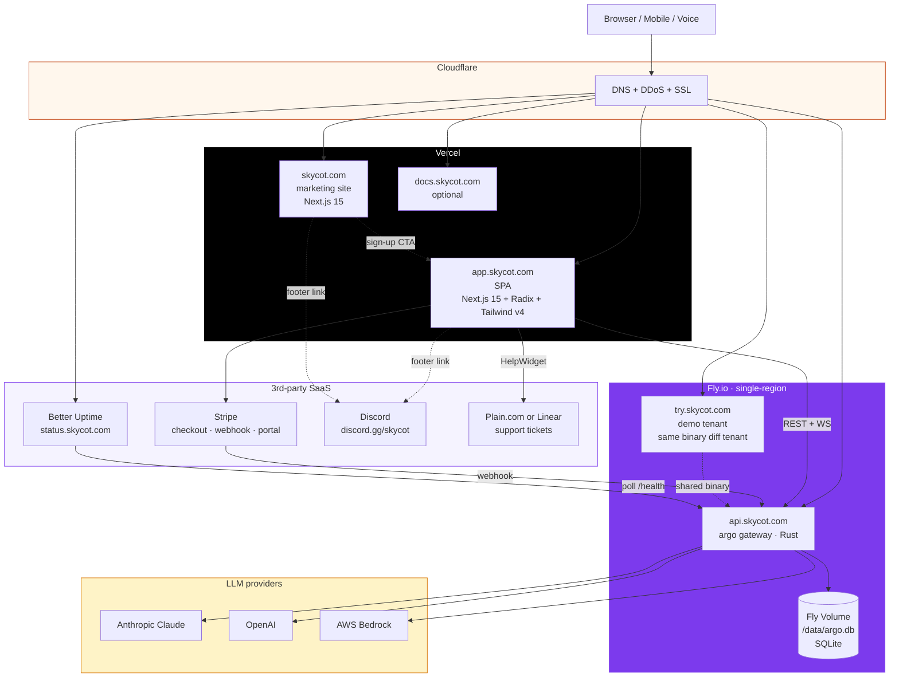

# 02 — Deployment topology

**Snapshot SHA:** `ed1ac928` (origin/main 2026-05-16)
**Update when:** new subdomain added, hosting provider changes, or DNS routing topology shifts.

Where each piece runs in production once Wave 2 deployment briefs land.

## Diagram

## Subdomain map

| Subdomain | Hosting | Purpose | Brief shipping it |
|---|---|---|---|
| `skycot.com` | Vercel | Marketing site | `claude-marketing-site-skycot-com` (TODO) |
| `app.skycot.com` | Vercel | SPA (product UI) | `codex-spa-vercel-deployment` (CLAIMED) |
| `api.skycot.com` | Fly.io | argo gateway (Rust binary) | `codex-hosted-deployment-flyio` (CLAIMED) |
| `try.skycot.com` | Fly.io | Demo tenant (shared binary) | same as `api`, different DNS+config |
| `status.skycot.com` | Better Uptime | Public status page | `claude-status-page-skycot` (TODO) |
| `docs.skycot.com` | Vercel (optional) | Hosted docs (Mintlify candidate) | DEFERRED v1.x |

## State of deploy briefs (2026-05-16)

- `codex-hosted-deployment-flyio` — CLAIMED (Dockerfile + fly.toml + secrets)
- `codex-spa-vercel-deployment` — CLAIMED (vercel.json + custom domain runbook)
- `codex-dns-cloudflare-setup` — TODO (depends on flyio + vercel)
- `claude-marketing-site-skycot-com` — TODO (separate Next.js marketing app)
- `claude-status-page-skycot` — TODO (Better Uptime recommended for 48hr scope)

## Notes

- **Single binary, single tenant per region.** Fly.io app runs one process; SQLite Volume holds all tenant data with tenant_id row-scoping.
- **DNS via Cloudflare.** All subdomains proxied (orange-cloud) for DDoS + automatic HTTPS + edge cache.
- **Vercel preview deployments per PR** — Next.js apps get automatic per-branch URLs.
- **Stripe webhook** routes to `api.skycot.com/api/v1/billing/webhook` with HMAC signature verification + idempotency (per `claude-stripe-subscription-integration` brief).
