# 10 — Worker turn loop (agent runner inner loop)

**Snapshot SHA:** `ed1ac928` (origin/main 2026-05-16)
**Update when:** the `turn::run` flow in `argo-agent-runner` changes, or new dispatch types are added.

What happens during ONE iteration of an agent worker: prompt assembled, LLM called, tools dispatched, audit emitted, next iteration triggered or terminal state reached.

## Diagram

```mermaid
flowchart TB
    START([Worker action queued<br/>or duty fires])

    SESSION[Session opened<br/>tenant_id + worker_id + spend ctx]

    HYDRATE[Prompt hydration<br/>turn_memory::compose<br/>+ load_prompt_skills_with_library<br/>+ vertical action vocab]

    BUILD_CTX[build_dispatch_ctx<br/>ToolContext + MemoryNs<br/>+ McpClientPool tenant-keyed]

    REGISTRY[builtin_tools_with_runtime<br/>15 in-core tools + Memory bound]

    CALL_LLM[Provider transport<br/>argo-provider::transport<br/>Anthropic / OpenAI / Bedrock]

    SPEND[SpendGate check<br/>per-tenant budget]

    DECISION{LLM<br/>response}

    TOOL_CALL[Tool call<br/>dispatch_one]
    CAP_CHECK[Capability check<br/>argo-capability::has]
    EXEC[Execute tool<br/>or executor]
    OUTCOME[ActionOutcome<br/>Completed / HumanHandoff /<br/>Failed / NeedsApproval]

    AUDIT[AuditSink::new_with_tenant<br/>chained SHA-256<br/>+ broadcast to /audit/stream]

    APPROVAL{Risk +<br/>policy gate?}
    ASK_OP[ask_operator<br/>via channel<br/>see 12-approval-flow]

    LEARN[skill_rating update<br/>per_worker_learning_cron<br/>picks this up later]

    LOOP_CHECK{More turns<br/>OR stop_reason?}

    TERMINAL[Terminal state<br/>session closed<br/>spend persisted]

    START --> SESSION
    SESSION --> HYDRATE
    HYDRATE --> BUILD_CTX
    BUILD_CTX --> REGISTRY
    REGISTRY --> CALL_LLM
    CALL_LLM --> SPEND
    SPEND --> DECISION

    DECISION -->|text response only| LOOP_CHECK
    DECISION -->|tool_use| TOOL_CALL
    TOOL_CALL --> CAP_CHECK
    CAP_CHECK -->|allow| EXEC
    CAP_CHECK -->|deny| AUDIT
    EXEC --> OUTCOME
    OUTCOME --> AUDIT
    AUDIT --> APPROVAL

    APPROVAL -->|auto-approve OR allowed| LOOP_CHECK
    APPROVAL -->|requires approval| ASK_OP
    ASK_OP --> LOOP_CHECK

    LOOP_CHECK -->|continue| CALL_LLM
    LOOP_CHECK -->|stop_success or budget exhausted| LEARN
    LEARN --> TERMINAL

    classDef start fill:#dcfce7,stroke:#16a34a
    classDef io fill:#dbeafe,stroke:#2563eb
    classDef decision fill:#fef3c7,stroke:#d97706
    classDef terminal fill:#fee2e2,stroke:#dc2626
    classDef audit fill:#f5f3ff,stroke:#7c3aed

    class START start
    class TERMINAL terminal
    class DECISION,APPROVAL,LOOP_CHECK decision
    class AUDIT audit
```

## Key invariants

- **Tenant pinned at session open** — every downstream tool/dispatch/audit row carries `session.tenant_id`. F-04 (#1727) wired this through `ToolContext`.
- **Memory namespace bound at registry build** — `Memory::with_namespace(store, ws, MemoryNs)` at `build_dispatch_ctx`. F-03 (#1737) wired this. `query_scored`/`list_team`/`read_team`/`write_team` are now reachable.
- **Spend gate on every provider call** — `argo-provider::SpendGate<T>` short-circuits if tenant budget exceeded.
- **Audit row per state transition** — turn start, tool call, tool result, approval ask, approval reply, terminal. Hash-chained per session.
- **No `unwrap()` outside `#[cfg(test)]`** — `CLAUDE.md` invariant.

## Source-of-truth pointers

- Turn loop: `crates/argo-agent-runner/src/turn.rs`
- Dispatch context: `crates/argo-agent-runner/src/dispatch.rs:21` (post-F-004 — no more nil tenant)
- Prompt hydration: `crates/argo-agent-runner/src/turn_helpers.rs:34`, `:154`
- Builtin tools: `crates/argo-tool/src/tools/mod.rs::builtin_tools_with_runtime`
