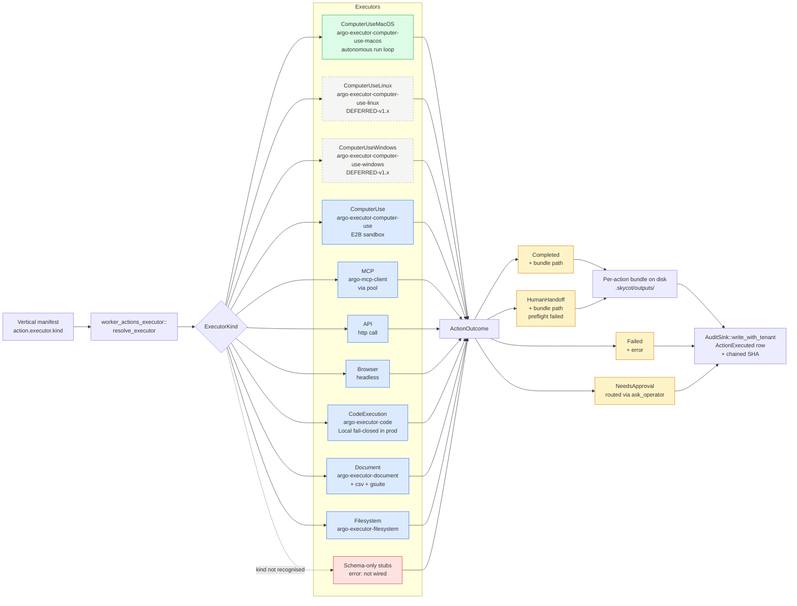

# 11 — Action execution flow

**Snapshot SHA:** `ed1ac928` (origin/main 2026-05-16)
**Update when:** new `ExecutorKind` variant added, or the resolver in `worker_actions_executor.rs` is restructured.

How a vertical manifest's named action becomes real execution: resolver picks an executor, executor runs, outcome is recorded.

## Diagram

## Key invariants

- **macOS-first for v1 demo.** `ComputerUseMacOS` returns `Completed` on `stop_success` (F-001b shipped #1722). `HumanHandoff` only on preflight failure (missing macOS Accessibility/Screen Recording permission).
- **Code execution fail-closed in production.** `Local` backend rejected when tenant policy says `allow_local_code_execution = false` (F-12 in flight, brief `codex-code-executor-sandbox-failclose`).
- **Every action emits an audit row.** Even failed dispatches. Chain stays continuous.

## Source-of-truth pointers

- Resolver: `crates/argo-cli/src/handlers/worker_actions_executor.rs::resolve_executor`
- macOS executor: `crates/argo-cli/src/handlers/worker_actions_executor_cu_macos.rs` + `crates/argo-executor-computer-use-macos/`
- Real macOS smoke: `crates/argo-cli/tests/cu_macos_dispatch_smoke.rs` (post-F-10, no more `argo --help`)
- Bundle layout: `.skycot/outputs/<job_id>/<action_id>/`
