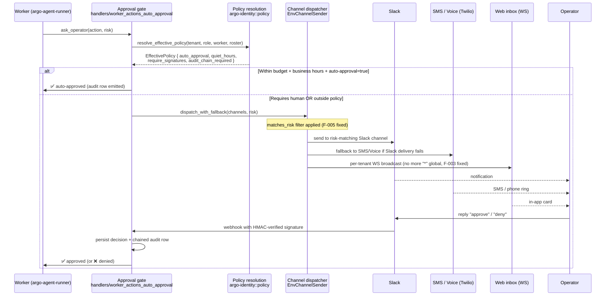

# 12 — Approval flow (multi-channel)

**Snapshot SHA:** `ed1ac928` (origin/main 2026-05-16)
**Update when:** new channel added to `EnvChannelSender`, or policy resolution order changes.

How an action moves from "I need approval" to "approved" or "denied" across Slack, email, SMS, push, voice, and web inbox.

## Diagram

## Channel inventory (live in `EnvChannelSender`)

| Channel | Status | Brief |
|---|---|---|
| `slack` | ✅ shipped | base |
| `email` | ✅ shipped | base |
| `sms` | ✅ shipped | base |
| `push` | ✅ shipped | base |
| `webinbox` | ✅ shipped, post-F-003 fix | #1720 |
| `discord` | ✅ shipped | base |
| `chat` | ✅ shipped | base |
| `sse` | ✅ shipped | base |
| `voice` | 🔄 in flight | `codex-channel-dispatcher-voice-completion` (PR #1741, conflicts) |
| `imessage` | DEFERRED-v1.x | brief explicitly defers |
| `whatsapp` | DEFERRED-v1.x | brief explicitly defers |
| `teams` | DEFERRED-v1.x | brief explicitly defers |
| `matrix` | DEFERRED-v1.x | brief explicitly defers |

## Policy resolution order (F-06 enforced #1742)

`argo-identity::policy::resolve_effective_policy(tenant_id, role, worker_id, roster)` walks in order:

1. Action-specific rules (vertical manifest action gates)
2. Worker policy (worker.toml)
3. Roster policy (team-level inheritance)
4. Workspace policy
5. Workspace defaults

Effective fields enforced (post-F-06):
- `auto_approval` — auto-approve if budget + time window match
- `quiet_hours` — gate-fail outside operator's time window
- `require_signatures` — N-of-M signature threshold
- `audit_chain_required` — fail-closed if AuditSink isn't chain-verified

## Key invariants

- **Risk-appropriate channel.** F-005 fix (#1738) ensures fallback dispatch filters channels by `matches_risk` before sending. Low-risk actions cannot accidentally route to high-risk-only channels and vice versa.
- **Tenant-scoped WS broadcast.** F-003 fix (#1720) removed `WsAuth::Legacy` global `"*"` broadcast — listeners only see their own tenant's events.
- **Audit chain on every state.** Each ask, reply, auto-approve, deny gets a chained audit row.

## Source-of-truth pointers

- Approval gate: `crates/argo-cli/src/handlers/worker_actions_auto_approval.rs`
- Channel dispatcher: `crates/argo-cli/src/handlers/worker_actions_notify.rs::EnvChannelSender`
- Fallback risk filter: `crates/argo-cli/src/handlers/worker_actions_notify_fallback.rs:74` (post-F-005)
- Policy resolver: `crates/argo-identity/src/policy.rs::resolve_effective_policy`
- WS inbox: `crates/argo-cli/src/handlers/gateway/ws_inbox_events.rs` (post-F-003)
- Slack signature verification: `crates/argo-cli/src/handlers/gateway/routes_channels_slack.rs:97`
