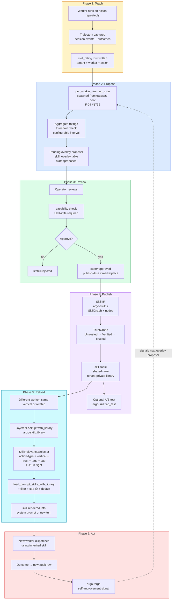
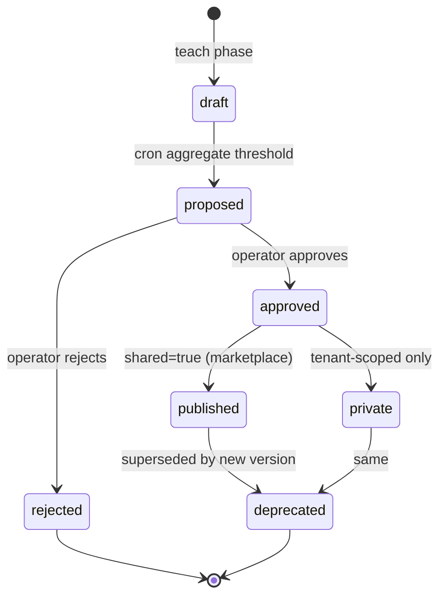

# 13 — Skill loop (Claim 4: shared and learned)

**Snapshot SHA:** `ed1ac928` (origin/main 2026-05-16)
**Update when:** new skill state added to `SkillStore`, or the layered-lookup priority order changes.

End-to-end loop: a worker learns a skill from repetition → operator approves → skill becomes available to other workers (Claim 4 of MISSION.md).

## Diagram

## State machine for a single skill

## Key invariants

- **Cross-tenant isolation.** Marketplace skills carry provenance; private library skills (`shared=false`) cannot leak across tenants. Enforced in `LayeredLookup::with_library` filter — verified by `end_to_end_claim4_loop.rs` test.
- **Trust grading.** `TrustGrade::{Untrusted, Verified, Trusted}` gates which skills make it into prompts under tenant policy. Default minimum: `Verified`.
- **Prompt budget cap.** Max 5 marketplace skills per turn (configurable). Prevents prompt pollution at scale.
- **Per-worker learning cron is now ACTUALLY runtime-spawned** (F-04 #1736 — pre-shipping it was a substrate gap; now lives in gateway boot).

## Source-of-truth pointers

- E2E proof: `crates/argo-skill/tests/end_to_end_claim4_loop.rs`
- Layered lookup: `crates/argo-skill/src/library.rs::LayeredLookup::with_library` (84)
- Learning cron: `crates/argo-skill/src/per_worker_learning_cron.rs::spawn_per_worker_learning_cron`
- Skill IR: `crates/argo-skill/src/ir/`
- Relevance selector: `crates/argo-skill/src/relevance_selector.rs` (F-11 in flight)
- Forge feedback: `crates/argo-forge/`
