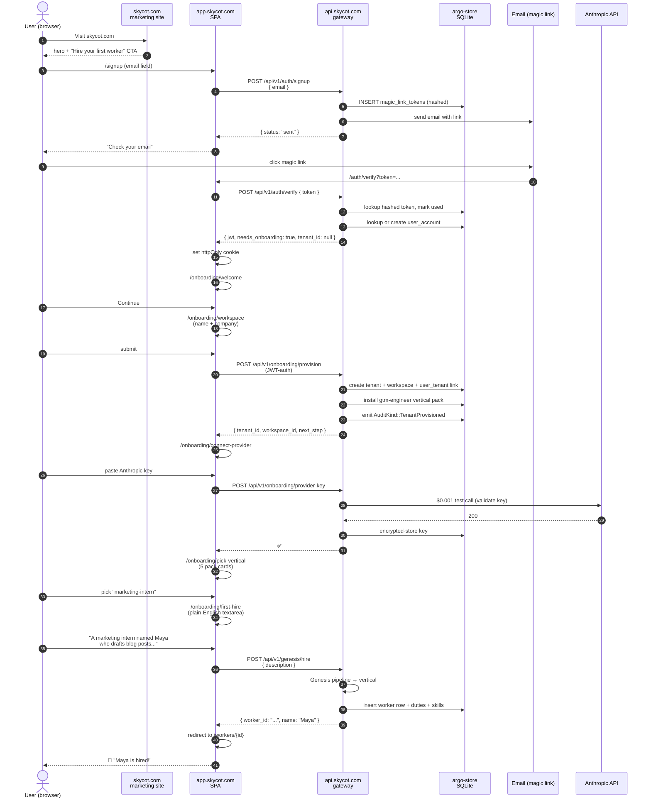
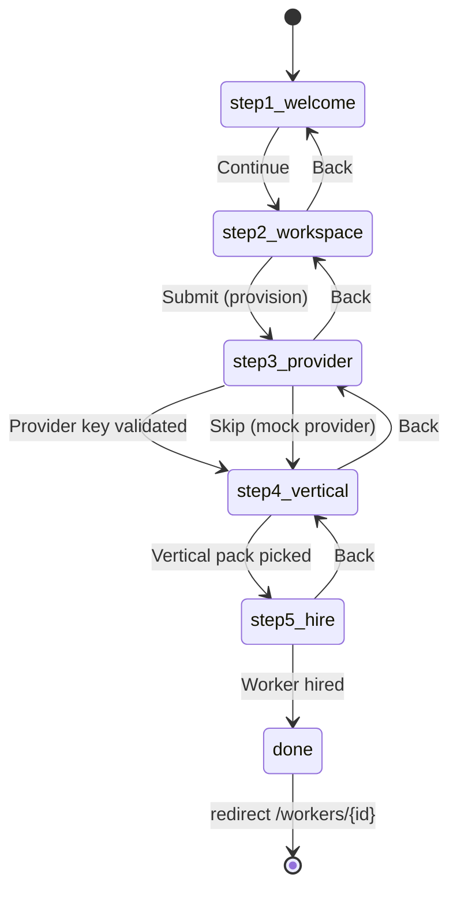

# 14 — Onboarding funnel (signup → first hire)

**Snapshot SHA:** `ed1ac928` (origin/main 2026-05-16)
**Update when:** signup flow changes, wizard adds/removes steps, or tenant-provisioning contract shifts.

The customer's first 90 seconds with SKYCOT. Just shipped via #1746 (signup) + #1748 (onboarding wizard). Tenant-provisioning backend is in flight.

## Diagram

## Funnel state machine (Zustand `useOnboardingDraft`)

## API endpoints used by funnel

| Endpoint | Method | Brief that shipped it |
|---|---|---|
| `/api/v1/auth/signup` | POST | `claude-magic-link-auth-backend` (CLAIMED) |
| `/api/v1/auth/verify` | POST | `claude-magic-link-auth-backend` (CLAIMED) |
| `/api/v1/onboarding/provision` | POST | `claude-tenant-provisioning-endpoint` (BLOCKED — substrate gap) |
| `/api/v1/onboarding/provider-key` | POST | implicit in wizard (uses existing provider config) |
| `/api/v1/onboarding/install-vertical` | POST | existing surface |
| `/api/v1/genesis/hire` | POST | existing Genesis pipeline |

## Current blockers (2026-05-16)

- **Tenant provisioning endpoint is BLOCKED** on substrate gap: the codebase uses UUID-keyed `TenantId` and `WorkspaceId` but has no row-backed `tenant` / `workspace` tables. The brief assumed tables exist; they don't. Either: (a) re-author after `claude-magic-link-auth-backend` merges with extended may-touch to add the tables, or (b) re-scope to use the existing UUID-only model.

## Source-of-truth pointers

- Signup landing: `web/app/auth/signup/page.tsx`
- Magic-link verify: `web/app/auth/verify/page.tsx`
- Onboarding wizard: `web/app/(setup)/onboarding/{welcome,workspace,connect-provider,pick-vertical,first-hire}/page.tsx`
- Draft persistence: `web/lib/onboarding/use-onboarding-draft.ts`
