# 21 — Audit chain

**Snapshot SHA:** `ed1ac928` (origin/main 2026-05-16)
**Update when:** `AuditKind` enum gains/loses variants, or the chain hash scheme changes.

Hash-chained audit log: every action emits a row chained via SHA-256 to the prior row in the same session. Provides tamper-evident provenance.

## Diagram

```mermaid
flowchart LR
    SESSION[Session start<br/>parent_hash = 0x000...]
    
    R1[Audit row 1<br/>kind: TurnStart<br/>payload: tenant + worker]
    H1[self_hash =<br/>sha256 parent_hash + kind + 0x00 + canonical_payload]
    
    R2[Audit row 2<br/>kind: ToolDispatch<br/>payload: tool args]
    H2[parent_hash = H1<br/>self_hash = sha256...]
    
    R3[Audit row 3<br/>kind: ActionExecuted<br/>payload: outcome + bundle]
    H3[parent_hash = H2<br/>self_hash = sha256...]
    
    R4[Audit row 4<br/>kind: ApprovalAsked<br/>payload: channel + risk]
    H4[parent_hash = H3<br/>self_hash = sha256...]
    
    R5[Audit row 5<br/>kind: ApprovalReplied<br/>payload: approved + signature]
    H5[parent_hash = H4<br/>self_hash = sha256...]
    
    R6[Audit row 6<br/>kind: TurnComplete<br/>payload: outcome + spend]
    H6[parent_hash = H5<br/>self_hash = sha256...]
    
    SESSION --> R1
    R1 --> H1
    H1 --> R2
    R2 --> H2
    H2 --> R3
    R3 --> H3
    H3 --> R4
    R4 --> H4
    H4 --> R5
    R5 --> H5
    H5 --> R6
    R6 --> H6

    VERIFY[verify_session<br/>walks chain<br/>flags ChainBreak]
    BROADCAST[AUDIT_BROADCAST_CAPACITY<br/>tokio broadcast<br/>→ /audit/stream WS]
    
    R6 --> VERIFY
    R1 -.->|fan-out| BROADCAST
    R2 -.->|fan-out| BROADCAST
    R3 -.->|fan-out| BROADCAST
    R4 -.->|fan-out| BROADCAST
    R5 -.->|fan-out| BROADCAST
    R6 -.->|fan-out| BROADCAST

    classDef row fill:#dbeafe,stroke:#2563eb
    classDef hash fill:#fef3c7,stroke:#d97706
    classDef verify fill:#dcfce7,stroke:#16a34a
    classDef bcast fill:#f3e8ff,stroke:#9333ea

    class R1,R2,R3,R4,R5,R6 row
    class H1,H2,H3,H4,H5,H6 hash
    class VERIFY verify
    class BROADCAST bcast
```



## Chain shape

Per `argo-audit/src/sink.rs`:

```
self_hash = sha256(parent_hash || kind_bytes || 0x00 || canonical_payload_json)
```

- First row in a session: `parent_hash = 0x000...` (32 zero bytes).
- Each subsequent row: `parent_hash = prior_row.self_hash`.
- Canonical JSON: keys sorted, no whitespace.

## AuditKind variants (post-F-005a)

| Kind | Emitted when |
|---|---|
| `TurnStart` | Worker turn begins |
| `ToolDispatch` | Any tool call attempted |
| `ToolResult` | Tool returns |
| `ActionExecuted` | Manifest action ran (with outcome) |
| `ApprovalAsked` | Auto-approval gate triggered ask |
| `ApprovalReplied` | Operator replied (approve / deny) |
| `TurnComplete` | Session terminal state |
| `TenantProvisioned` | New tenant created (post F-04 #1737) |
| `SkillPublished` | Skill marketplace publish event |
| `HttpRequest` | Per-request audit (gateway) |
| `OperatorFeedback` | up/down vote on action |
| `SsoLogin` | OIDC / SAML successful auth |
| `SettingsChanged` | Tenant config mutation |
| `(more)` | See `crates/argo-audit/src/event.rs` |

## Tenant scoping (post F-005b)

Every audit row carries `tenant_id`. The `AuditSink::new` constructor (which defaulted to `ws-default`) is `#[deprecated]` — production code MUST use `AuditSink::new_with_tenant(store, tenant_id)`. CI `-D warnings` fails any deprecation use in production. (F-05b shipped #1728.)

Plus `SYSTEM_AUDIT_TENANT_ID = "system"` and `ANONYMOUS_AUDIT_TENANT_ID = "anonymous"` for legitimate cross-tenant / pre-auth flows (post F-05a #1726).

## Real-time fan-out

`AuditSink` also fans newly-written rows out via `tokio::sync::broadcast` with `AUDIT_BROADCAST_CAPACITY` buffered. The gateway's `/audit/stream` WS endpoint subscribes and pushes rows to live audit-tail clients without polling.

## Verification

- `verify_session(session_id) -> Result<(), ChainBreak>` — walks rows, recomputes hashes, flags any break.
- `verify_all() -> Vec<ChainBreak>` — sweep verification (CLI: `argo audit verify`).
- CI `audit.yml` runs `cargo deny audit` for security advisories (separate from chain verification).

## Source-of-truth pointers

- Sink: `crates/argo-audit/src/sink.rs::AuditSink`
- Tenant module: `crates/argo-audit/src/sink_tenant.rs` (split per F-005a)
- Chain hash: `crates/argo-audit/src/sink.rs::compute_chain_hash`
- Verify: `crates/argo-audit/src/verify.rs::verify_session`
- Audit kinds enum: `crates/argo-audit/src/event.rs::AuditKind`
- Audit stream WS: `crates/argo-cli/src/handlers/gateway/routes_audit_stream.rs`
