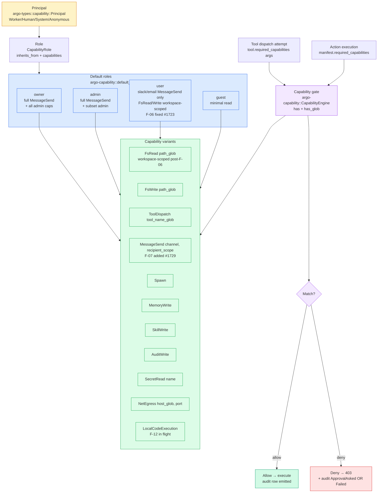
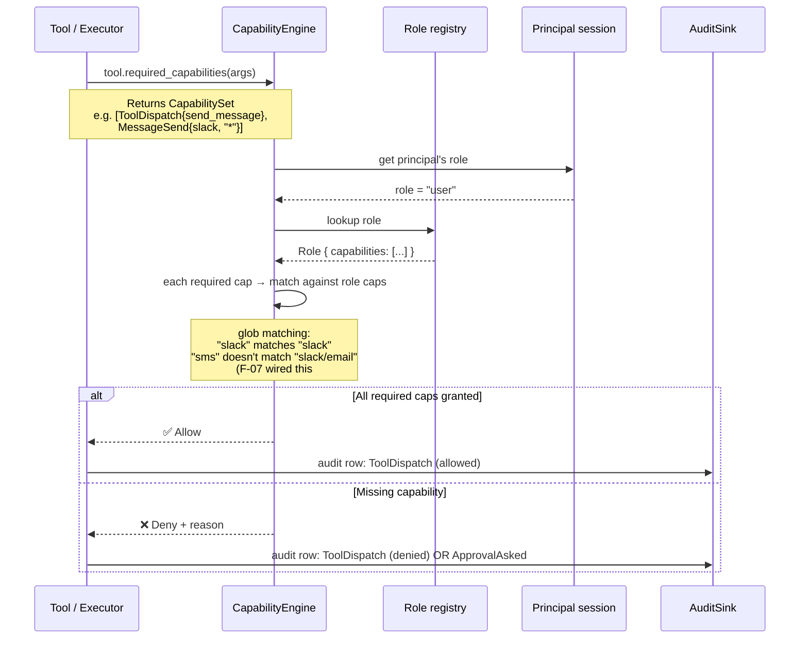

# 22 — Capability + RBAC

**Snapshot SHA:** `ed1ac928` (origin/main 2026-05-16)
**Update when:** `Capability` enum gains/loses variants, or default-role assignments change.

How SKYCOT enforces "this principal can do this thing" — capability declarations on tools/actions matched against role grants.

## Diagram

## Capability lifecycle

## Key invariants

- **Workspace-scoped fs defaults** — F-06 (#1723) replaced the permissive `"**"` placeholder with `{workspace_root}/**` interpolation. Default `user` role can only read/write inside its workspace.
- **Per-channel send capability** — F-07 (#1729) added `Capability::MessageSend{channel, recipient_scope}`. `ToolDispatch{send_message}` alone is no longer enough; high-risk channels need explicit grant.
- **No `Capability::LocalCodeExecution` in default roles** — F-12 (in flight) ensures Local sandbox backend fails closed unless tenant explicitly grants.
- **Glob matching is conservative** — `FsRead{path_glob: "/workspace/**"}` does NOT match `/etc/passwd`.

## Source-of-truth pointers

- Capability enum: `crates/argo-types/src/capability.rs::Capability`
- Engine: `crates/argo-capability/src/lib.rs::CapabilityEngine`
- Default roles: `crates/argo-capability/src/lib.rs::default_roles_for_workspace`
- Send-message gate: `crates/argo-tool/src/tools/send_message.rs::required_capabilities`
- Auto-approval gate: `crates/argo-cli/src/handlers/worker_actions_auto_approval.rs`
