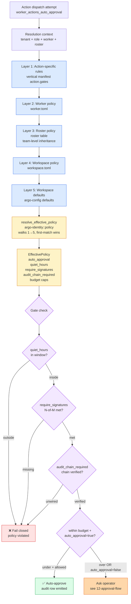

# 23 — Policy-as-code resolution

**Snapshot SHA:** `ed1ac928` (origin/main 2026-05-16)
**Update when:** policy layer order changes, or new effective-policy field added.

Auto-approval policy is layered — action-specific → worker → roster → workspace → defaults — and resolves to one `EffectivePolicy` per request. F-06 (#1742) made this real (was previously paper-only with empty role/tenant strings).

## Diagram

## EffectivePolicy fields (enforced post F-06)

| Field | Type | Effect when set |
|---|---|---|
| `auto_approval` | bool | If true AND within budget+time → auto-approve |
| `quiet_hours` | `TimeWindow` | Outside window → fail closed (no auto-approve) |
| `require_signatures` | `{ n: 2, of: 3 }` | If non-zero → must have N approvers; below = fail closed |
| `audit_chain_required` | bool | If true AND audit chain not verifiable → fail closed |
| `budget` | `{ max_per_action, max_per_day, currency }` | Numeric gate |
| `allowed_channels` | `Vec<String>` | Restricts which channels can fire approval asks |
| `prohibited_actions` | `Vec<String>` | Manifest action names that are always refused |

## Pre-F-06 vs post-F-06

**Before F-06 (paper-only):**
- `resolve_effective_policy("", "", worker_id, None)` — empty role + tenant
- Roster never consulted (always None)
- `quiet_hours` / `require_signatures` / `audit_chain_required` parsed but never gate-checked
- V1 success scenario #4 ("auto-approve weekday business hours") was inert

**After F-06 (#1742):**
- Real tenant_id (from session), real role (from worker.role_name), real roster (from `Worker::resolved_policy_with_rosters`)
- All effective fields enforced fail-closed
- Test coverage: 5 regression tests in `worker_actions_auto_approval_tests.rs`

## Key invariants

- **Fail closed on any unsupported field.** If a field is set but the gate doesn't know how to enforce, action is denied (escalate to manual).
- **Quiet hours respect tenant timezone.** Resolved from `workspace.timezone` or operator config.
- **N-of-M signatures persist.** Approval responses are signed (HMAC) — F-07 channel response adds explicit signature row to audit.

## Source-of-truth pointers

- Policy module: `crates/argo-identity/src/policy.rs::resolve_effective_policy` (`:17`)
- Worker policy resolver: `crates/argo-identity/src/roster.rs::Worker::resolved_policy_with_rosters`
- Approval gate: `crates/argo-cli/src/handlers/worker_actions_auto_approval.rs` (post F-06)
- Regression tests: `crates/argo-cli/src/handlers/worker_actions_auto_approval_tests.rs`
