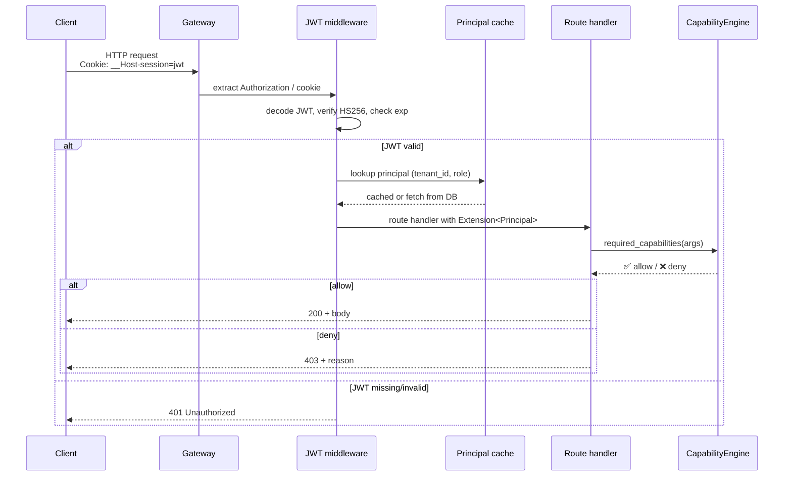

# 30 — API routes (gateway HTTP surface)

**Snapshot SHA:** `ed1ac928` (origin/main 2026-05-16)
**Update when:** new `routes_*.rs` file added/removed, or auth surface changes.

The gateway exposes ~125 `routes_*.rs` files under `crates/argo-cli/src/handlers/gateway/`. They're grouped by resource. Every route is mounted by `boot.rs` onto an axum `Router` and gated by the JWT middleware (except `/healthz`, `/auth/*`, and SCIM webhooks).

## Diagram (resource-grouped)

```mermaid
flowchart LR
    CLIENT[Client<br/>SPA / TUI / CLI / curl]
    
    JWT[JWT middleware<br/>routes_auth_principal]
    
    subgraph HEALTH[Health/Meta unauth]
        H1[/GET /healthz/]
        H2[/GET /meta/tools/]
        H3[/GET /meta/]
    end
    
    subgraph AUTH[Auth unauth]
        A1[/POST /api/v1/auth/signup/]
        A2[/POST /api/v1/auth/verify/]
    end
    
    subgraph CORE[Core gateway authed]
        C1[/GET POST /dispatch/*<br/>get/post/admin/api/catalog]
        C2[/GET POST /session/*<br/>get/audit_rollups/clone/<br/>export/skills/stats/<br/>approval]
        C3[/GET /workers/:id/*<br/>activity/detail/memory/<br/>overview/policies/<br/>settings/trust_grade]
        C4[/POST /workers/hire/]
        C5[/GET POST /skills/*<br/>show/quality/IR/refine/<br/>lifecycle]
        C6[/GET POST /evals/]
        C7[/GET POST /duties/]
        C8[/GET POST /cohorts/]
        C9[/GET POST /retros/]
    end
    
    subgraph AUDIT[Audit/Observability]
        AU1[/GET /audit/feed?scope=*/]
        AU2[/GET /audit/detail/:id/]
        AU3[/GET /audit/rollups/]
        AU4[/GET /audit/screenshot/:id/]
        AU5[/GET /audit/session/:sid/]
        AU6[/WS /audit/stream/]
        AU7[/GET /audit/request_audit/]
    end
    
    subgraph CHANNELS[Channels Inbox + Egress]
        CH1[/POST /channels/slack/*/]
        CH2[/POST /channels/email/*/]
        CH3[/POST /channels/discord/*/]
        CH4[/POST /channels/whatsapp/*/]
        CH5[/POST /channels/imessage/*/]
        CH6[/POST /channels/voice/*<br/>+ /voice_auth/]
        CH7[/POST /channels/push/*/]
        CH8[/GET POST /channels/webinbox/*/]
    end
    
    subgraph FORGE[Forge/Eval]
        F1[/POST /forge/*<br/>promote/runs_list/<br/>rollups/audit/]
        F2[/POST /retrain/*/]
        F3[/POST /ghostwriter/]
    end
    
    subgraph ORCH[Orchestration]
        O1[/GET POST /orchestration/]
        O2[/GET POST /orchestrator/*<br/>handoffs/slas/]
        O3[/GET POST /cron/]
    end
    
    subgraph PROVISION[Provisioning]
        P1[/POST /genesis/hire/]
        P2[/GET POST /providers/]
        P3[/GET POST /verticals/*<br/>doctor/lint/run/]
        P4[/POST /wizard/*/]
        P5[/POST /onboarding/*<br/>provision/provider-key/<br/>install-vertical/]
    end
    
    subgraph MARKETPLACE[Marketplace]
        M1[/GET /catalog/]
        M2[/GET POST /workspace/]
        M3[/GET /lists/*<br/>+ /lists/memory/]
        M4[/GET /search/]
        M5[/GET /counts/]
    end
    
    subgraph METRICS[Metrics scrape]
        ME1[/GET /metrics<br/>text/json/openmetrics/]
        ME2[/GET /metrics/actions/]
        ME3[/GET /costs_by_day/]
        ME4[/GET /messages_rollups/<br/>+ recent/]
        ME5[/GET /sessions_rollups/]
        ME6[/GET /top + /top_sessions/]
        ME7[/GET /dispatch_rollups/]
    end
    
    subgraph SCIM[SCIM SSO unauth bearer]
        S1[/GET POST PUT DELETE<br/>/scim/v2/Users/]
    end
    
    subgraph ELEVATED[Elevated views authed + capability]
        E1[/GET /elevated_view/]
        E2[/POST /post_admin/]
        E3[/POST /worker_settings_danger/]
    end
    
    CLIENT --> HEALTH
    CLIENT --> AUTH
    CLIENT --> JWT
    JWT --> CORE
    JWT --> AUDIT
    JWT --> CHANNELS
    JWT --> FORGE
    JWT --> ORCH
    JWT --> PROVISION
    JWT --> MARKETPLACE
    JWT --> METRICS
    JWT --> ELEVATED
    CLIENT --> SCIM

    classDef unauth fill:#dcfce7,stroke:#16a34a
    classDef core fill:#dbeafe,stroke:#2563eb
    classDef obs fill:#fef3c7,stroke:#d97706
    classDef chan fill:#cffafe,stroke:#0891b2
    classDef forge fill:#f3e8ff,stroke:#9333ea
    classDef orch fill:#fed7aa,stroke:#ea580c
    classDef prov fill:#e0e7ff,stroke:#4f46e5
    classDef mkt fill:#fce7f3,stroke:#db2777
    classDef met fill:#d1fae5,stroke:#059669
    classDef scim fill:#fee2e2,stroke:#dc2626
    classDef elev fill:#fef2f2,stroke:#991b1b

    class HEALTH,AUTH unauth
    class CORE core
    class AUDIT obs
    class CHANNELS chan
    class FORGE forge
    class ORCH orch
    class PROVISION prov
    class MARKETPLACE mkt
    class METRICS met
    class SCIM scim
    class ELEVATED elev
```

## Most-used endpoints (canonical contract)

| Endpoint | Method | Purpose | Source |
|---|---|---|---|
| `/healthz` | GET | Liveness + readiness | `routes_health.rs` |
| `/meta/tools` | GET | List in-core + MCP tools | `routes_meta_tools.rs` |
| `/api/v1/auth/signup` | POST | Magic-link email → token | `routes_auth.rs` |
| `/api/v1/auth/verify` | POST | Token → JWT + needs_onboarding | `routes_auth.rs` |
| `/dispatch` | POST | Run a tool by name (legacy) | `routes_dispatch_post.rs` |
| `/dispatch/get` | GET | Browse dispatch history | `routes_dispatch_get.rs` |
| `/workers` | GET | List tenant's workers | `routes_team_list.rs` |
| `/workers/hire` | POST | Genesis hire flow | `routes_workers_hire.rs` |
| `/workers/:id/overview` | GET | Worker dashboard data | `routes_worker_overview.rs` |
| `/session/:id` | GET | Session detail + chain | `routes_session_get.rs` |
| `/session/:id/export` | GET | Tarball: bundle + audit + skills | `routes_session_get_export.rs` |
| `/audit/feed` | GET | Filtered audit rows | `routes_audit_feed.rs` |
| `/audit/stream` | WS | Live audit tail | `routes_audit_stream.rs` |
| `/audit/detail/:row_id` | GET | Single audit row + chain context | `routes_audit_detail.rs` |
| `/skills` | GET/POST | Skill marketplace | `routes_skills.rs` |
| `/channels/slack/inbox` | POST | Slack event ingestion | `routes_channels_slack.rs` |
| `/channels/email/inbox` | POST | Postmark/SendGrid inbound | `routes_channels_email.rs` |
| `/channels/webinbox` | POST | SPA-native channel | `routes_channels_webinbox.rs` |
| `/metrics` | GET | Prometheus text/openmetrics | `routes_openmetrics.rs` |
| `/scim/v2/Users` | * | SCIM 2.0 SSO provisioning | `routes_scim_users.rs` |

## Auth and authz model



## WebSocket endpoints

| Endpoint | Purpose | Auth |
|---|---|---|
| `/audit/stream` | Live audit-row push (tokio broadcast) | JWT cookie |
| `/channels/webinbox/ws` | Bidirectional SPA-native channel | JWT cookie |
| `/orchestration/ws` | Live orchestrator state | JWT cookie |

(Per F-03 #1720, `/audit/stream` no longer broadcasts to `tenant_key="*"` — strictly per-tenant.)

## Key invariants

- **Every route is mounted in `boot.rs`.** No "side-door" routers. Grep `boot.rs` for the canonical list.
- **JWT extraction is single-source.** `routes_auth_principal.rs::PrincipalExtractor` — no parallel extractors.
- **Routes_* file == 1 resource.** Discoverability — find file by resource name. Tests live in `routes_*_tests.rs`.
- **OpenAPI surfaces at `/meta/openapi.json`** (where exposed) — though most discovery is via `/meta/tools`.

## Source-of-truth pointers

- Router assembly: `crates/argo-cli/src/handlers/gateway/boot.rs`
- Route handlers: `crates/argo-cli/src/handlers/gateway/routes_*.rs` (~125 files)
- JWT extractor: `crates/argo-cli/src/handlers/gateway/routes_auth_principal.rs`
- Audit WS: `crates/argo-cli/src/handlers/gateway/routes_audit_stream.rs`
- Health: `crates/argo-cli/src/handlers/gateway/routes_health.rs`
