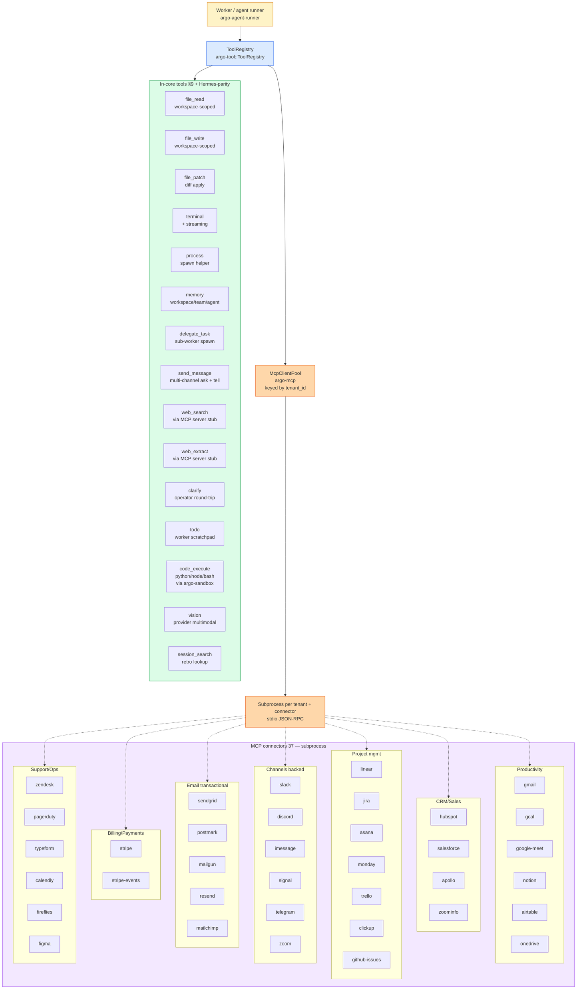
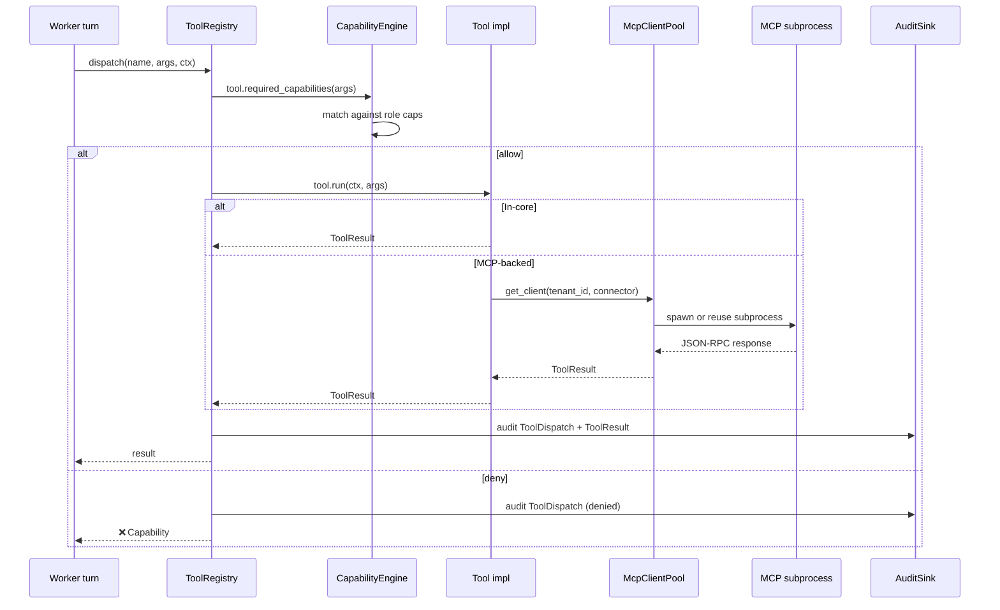

# 32 — In-core tool surface + MCP connectors

**Snapshot SHA:** `ed1ac928` (origin/main 2026-05-16)
**Update when:** tool added/removed from `crates/argo-tool/src/tools/`, or MCP connector added/removed.

SKYCOT exposes two tool surfaces: **in-core tools** (compiled into the gateway binary, ~15 tools per `crates/argo-tool/src/tools/mod.rs`) and **MCP connectors** (37 subprocess-spawned tools per `crates/argo-mcp-connector-*`). The architecture invariant: **MCP-first integration** — only 8 tools were specified for in-core; the rest live as MCP servers.

## Diagram

## In-core tool roster (canonical)

| Tool | Module | Status | Capability gate |
|---|---|---|---|
| `file_read` | `tools/file_read.rs` | End-to-end | `Capability::FsRead{path_glob}` |
| `file_write` | `tools/file_write.rs` | End-to-end | `Capability::FsWrite{path_glob}` |
| `file_patch` | `tools/file_patch.rs` | End-to-end | `Capability::FsWrite{path_glob}` |
| `terminal` | `tools/terminal.rs` + `terminal_streaming.rs` | End-to-end | `Capability::ToolDispatch{terminal}` |
| `process` | `tools/process.rs` | End-to-end | `Capability::Spawn` |
| `memory` | `tools/memory.rs` + `_namespace_tests.rs` | End-to-end (F-03 #1737) | `Capability::MemoryWrite` |
| `delegate_task` | `tools/delegate_task.rs` | End-to-end | `Capability::Spawn` |
| `send_message` | `tools/send_message.rs` | End-to-end (F-07 #1729) | `Capability::MessageSend{channel, scope}` |
| `web_search` | `tools/web/search.rs` | MCP-backed (schema-only stub) | `Capability::NetEgress` |
| `web_extract` | `tools/web/extract.rs` | MCP-backed (schema-only stub) | `Capability::NetEgress` |
| `clarify` | `tools/clarify.rs` | End-to-end | (no gate — escalation primitive) |
| `todo` | `tools/todo.rs` | End-to-end | (worker-local) |
| `code_execute` | `tools/code_execute.rs` | End-to-end (sandboxed) | `Capability::LocalCodeExecution` (F-12 in-flight) |
| `vision` | `tools/vision.rs` | End-to-end | `Capability::ToolDispatch{vision}` |
| `session_search` | `tools/session_search.rs` | End-to-end | `Capability::ToolDispatch{session_search}` |

## MCP connector roster (37 total)

| Category | Connectors | Status notes |
|---|---|---|
| Productivity | gmail, gcal, google-meet, notion, airtable, onedrive | Production-ready |
| CRM/Sales | hubspot, salesforce, apollo, zoominfo | apollo + zoominfo: DEFERRED-v1.x (enterprise stubs) |
| PM | linear, jira, asana, monday, trello, clickup, github-issues | Production-ready |
| Comms | slack, discord, imessage, signal, telegram, zoom | signal + telegram: SCHEDULED-DELETE-v1 (consumer); zoom: DEFERRED-v1.x |
| Email tx | sendgrid, postmark, mailgun, resend, mailchimp | mailgun + resend: SCHEDULED-DELETE-v1 (redundant) |
| Billing | stripe, stripe-events | Production-ready |
| Support/Ops | zendesk, pagerduty, typeform, calendly, fireflies, figma | Production-ready |
| Shared scaffold | `argo-mcp-connector-shared` | Common subprocess plumbing |

## Tool dispatch flow

## Key invariants

- **MCP-first** — if it's not one of the 8 §9 + 7 Hermes-parity tools, it's MCP. No new tools land in-core without architectural review.
- **MCP pool keyed by tenant.** Different tenants never share subprocess credentials. (Per F-04 #1727 multi-tenancy.)
- **Workspace-scoped fs by default.** `file_read`/`file_write` paths interpolated against `{workspace_root}` (F-06 #1723).
- **Per-channel send capability.** `send_message` requires `Capability::MessageSend{channel, recipient_scope}`; `ToolDispatch{send_message}` alone is no longer enough (F-07 #1729).
- **No `unwrap`/`expect` outside test code** — CI gates this.

## Source-of-truth pointers

- Tool trait: `crates/argo-tool/src/tool.rs::Tool`
- Tool registry: `crates/argo-tool/src/registry.rs::ToolRegistry`
- Tools mod: `crates/argo-tool/src/tools/mod.rs`
- MCP pool: `crates/argo-mcp/src/pool.rs::McpClientPool`
- Send-message dispatcher: `crates/argo-tool/src/tools/send_message.rs::MessageDispatcher`
- Connector crates: `crates/argo-mcp-connector-*` (37 total)
- Connector shared lib: `crates/argo-mcp-connector-shared/`
