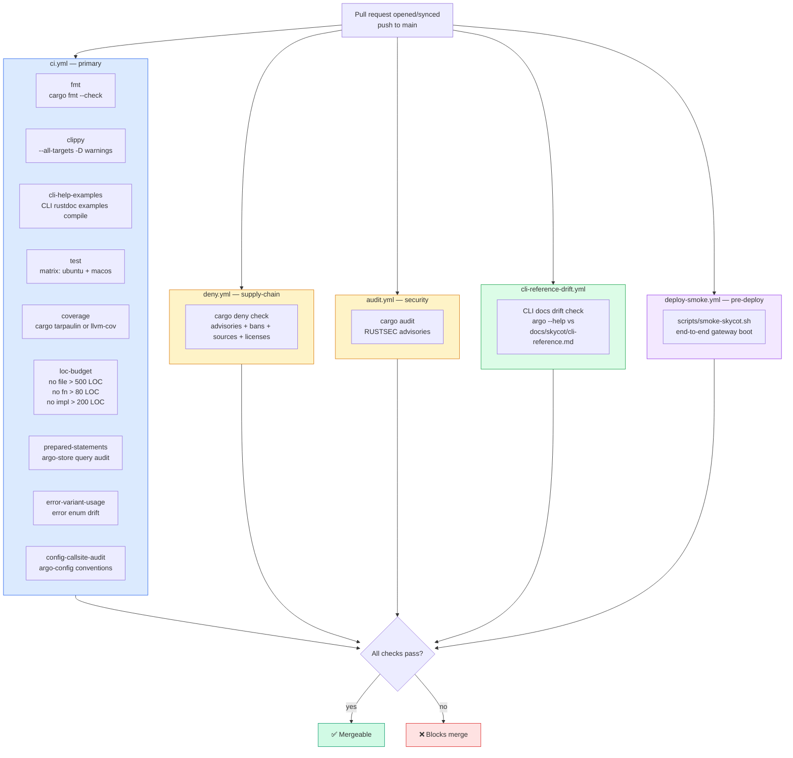

# 40 — CI pipeline

**Snapshot SHA:** `ed1ac928` (origin/main 2026-05-16)
**Update when:** workflow added/enabled/disabled, or CI gate becomes blocking.

5 active GitHub Actions workflows guard the merge gate. The architecture invariants (§9 single-binary, <500 LOC per file, no `unwrap` outside tests, etc.) are enforced as CI jobs — not just convention.

## Diagram

## ci.yml job breakdown

| Job | Purpose | Blocking |
|---|---|---|
| `fmt` | `cargo fmt --check` — formatter drift | ✅ |
| `clippy` | `cargo clippy --all-targets --all-features -- -D warnings` — lint + deprecation | ✅ |
| `cli-help-examples` | Compile every CLI rustdoc example | ✅ |
| `test` | `cargo test --workspace` on ubuntu + macos (matrix) | ✅ |
| `coverage` | Coverage delta (informational) | ⚠️ Informational |
| `loc-budget` | Architecture invariants: no file > 500 LOC, fn > 80, impl > 200 | ✅ |
| `prepared-statements` | Detect raw query interpolation in argo-store | ✅ |
| `error-variant-usage` | Catch drift in error enum usage | ✅ |
| `config-callsite-audit` | argo-config call-site lint | ✅ |

## Other workflows

| Workflow | Triggers | Purpose |
|---|---|---|
| `deny.yml` | push + PR | `cargo deny check advisories bans sources licenses` |
| `audit.yml` | push + PR | `cargo audit` for RUSTSEC advisories |
| `cli-reference-drift.yml` | push + PR touching CLI | Drift check between live CLI `--help` and `docs/skycot/cli-reference.md` |
| `deploy-smoke.yml` | push to main | End-to-end gateway smoke (`scripts/smoke-skycot.sh`) — gates production deploys |

## Disabled workflows (not active)

| Workflow | Status reason |
|---|---|
| `bench.yml.disabled` | Bench infra not stable v1 |
| `docs.yml.disabled` | mdBook not configured |
| `fuzz-nightly.yml.disabled` | Pending cargo-fuzz allowlist |
| `oci-smoke.yml.disabled` | No OCI release target v1 |
| `real-llm-smoke.yml.disabled` | Cost gating — runs on operator demand |
| `release.yml.disabled` | Release pipeline TBD |
| `schema-doc-check.yml.disabled` | Pending JSON schema export |
| `silent-skip-nightly.yml.disabled` | Tracks `#[ignore]` accumulation |
| `soak.yml.disabled` | Multi-hour soak — operator-triggered |

## Architecture invariants enforced

These CI gates are the **mechanical guard** for the invariants stated in `CLAUDE.md`:

| CLAUDE.md invariant | Enforcing job |
|---|---|
| No file > 500 LOC | `loc-budget` |
| No fn > 80 LOC | `loc-budget` |
| No struct impl block > 200 LOC | `loc-budget` |
| No `unsafe` outside FFI shims | `clippy` (with custom lint config) |
| No `unwrap`/`expect` outside `#[cfg(test)]` | `clippy` (with custom config) |
| No global mutable state | (manual review — not yet CI-gated) |
| Every public Rust API has rustdoc + example | `cli-help-examples` (partial) |

## Source-of-truth pointers

- Workflows: `.github/workflows/{ci,deny,audit,cli-reference-drift,deploy-smoke}.yml`
- LOC budget script: `scripts/check-loc-budget.sh` (or inlined in ci.yml)
- Smoke script: `scripts/smoke-skycot.sh`
- CLI reference doc: `docs/skycot/cli-reference.md`
- cargo-deny config: `deny.toml` (workspace root)
