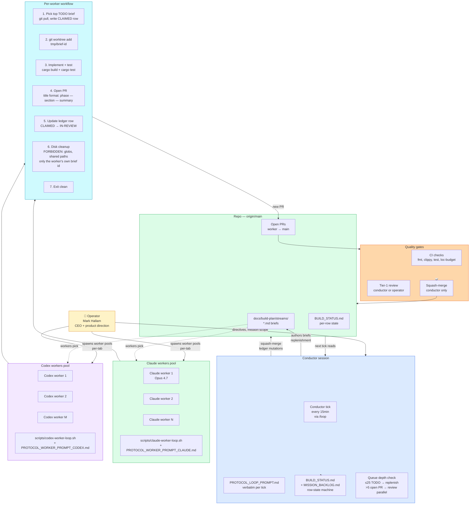

# 41 — Swarm architecture (operator / conductor / workers)

**Snapshot SHA:** `ed1ac928` (origin/main 2026-05-16)
**Update when:** swarm protocol changes, agent family pool changes, or new worker prompt shipped.

How SKYCOT is being built: an operator-supervised multi-agent swarm where a single **conductor** session manages a ledger (`docs/build-plan/BUILD_STATUS.md`) and N parallel **workers** (claude + codex pools) each claim one brief, build in a `/tmp/<brief-id>/` worktree, and PR back to `origin/main`.

## Diagram



## Row-state machine (ledger)

```mermaid
stateDiagram-v2
    [*] --> TODO: brief authored
    TODO --> CLAIMED: worker claims
    CLAIMED --> IN_REVIEW: PR opened
    IN_REVIEW --> MERGED: squash-merged
    IN_REVIEW --> BLOCKED: conflict or substrate gap
    IN_REVIEW --> DIRTY: rebase needed
    DIRTY --> IN_REVIEW: rebased
    BLOCKED --> TODO: re-scoped
    BLOCKED --> STALE-FIXED: superseded
    CLAIMED --> TODO: worker abandoned
    MERGED --> [*]
    STALE-FIXED --> [*]
```

## Conductor responsibilities (per tick)

Per `docs/build-plan/PROTOCOL_LOOP_PROMPT.md`:

1. **Open ledger + queue depth check.** `git pull --rebase origin main`, read `BUILD_STATUS.md` header.
2. **Replenish if claude TODO ≤ 25.** Author new briefs from `MISSION_BACKLOG.md`.
3. **Spawn parallel PR-review agent if open PRs > 5.** `general-purpose` subagent, read-only.
4. **Tier-1 review + squash-merge clean PRs.** Conductor-only mutation.
5. **Triage BLOCKs.** Surface to operator if substrate-level; re-scope if not.
6. **Update ledger rows.** State transitions, replenishment commits.
7. **Drift sweep.** `scripts/find-stale-claim-drift.py --quiet`.
8. **Atomic shell pattern.** `python3 mutation && git add+commit+push` chained — no half-states.

## Worker responsibilities (per iteration)

Per `PROTOCOL_WORKER_PROMPT_CLAUDE.md` and `PROTOCOL_WORKER_PROMPT_CODEX.md`:

1. **Pull origin/main.** Read ledger top-of-TODO matching family prefix.
2. **Claim by writing row** (CLAIMED state).
3. **Worktree:** `git worktree add /tmp/<brief-id>` and `cd` in.
4. **Read brief end-to-end.** Validate freshness (`scripts/check-brief-freshness.sh`).
5. **Implement.** No scope expansion. Tests required.
6. **CI-clean PR.** `cargo fmt`, `cargo clippy -- -D warnings`, `cargo test --workspace`.
7. **Open PR.** Title format `phase — section — summary`.
8. **Update ledger.** CLAIMED → IN-REVIEW.
9. **Disk cleanup.** Strictly scoped to own `BRIEF_ID`; FORBIDDEN list (no globs, no shared paths, no other workers' worktrees).
10. **Exit clean.** No background work, no dangling state.

## Hard rules

- **Conductor never pushes feature code.** Only conductor mutations: squash-merges, ledger row updates, replenishment commits, BLOCKED triage.
- **Workers never edit conductor docs.** `BUILD_STATUS.md` row writes only; no `PROTOCOL_*.md` edits.
- **Disk-cleanup safety:** strict per-worker scope. Empty `BRIEF_ID` aborts. No `rm -rf /tmp/*`.
- **Atomic mutations.** Always `python3 update.py && git add ledger && git commit -m '...' && git push origin main` chained.
- **Freshness gate.** Briefs declare `Authored against: origin/main <SHA> on <YYYY-MM-DD>`; stale > 72h refused at claim time.
- **No "land scaffold now, wire later".** Grep before write. Every new pub surface names its consumer.

## Stop conditions

The swarm halts on any of:

- **v1.0 ship gate met:** `docs/skycot/demos/v1-mission-mvp.mp4` exists AND `scripts/smoke-skycot.sh` passes.
- **Operator interrupt.** Manual halt of conductor tab.
- **Queue exhausted.** All TODO and MISSION_BACKLOG entries shipped or DEFERRED.
- **Substrate-level BLOCK** the conductor cannot work around (escalates to operator).

## Active worker prompts

| File | Pool | Purpose |
|---|---|---|
| `docs/build-plan/PROTOCOL.md` | shared | architecture + anti-patterns |
| `docs/build-plan/SWARM_PROTOCOL.md` | shared | iteration sequence, rules, exit |
| `docs/build-plan/PROTOCOL_LOOP_PROMPT.md` | conductor | per-tick prompt verbatim |
| `docs/build-plan/PROTOCOL_WORKER_PROMPT_CLAUDE.md` | claude | per-iteration claude worker prompt |
| `docs/build-plan/PROTOCOL_WORKER_PROMPT_CODEX.md` | codex | per-iteration codex worker prompt |
| `docs/build-plan/CONTRIBUTING_AGENT.md` | shared | short worker companion |
| `docs/build-plan/RESUME.md` | shared | fresh-session primer |
| `AGENTS.md` | shared | repo-root cleanup mandate + link |

## Source-of-truth pointers

- Conductor loop: `scripts/conductor-tick.sh` (if extracted) or runtime via `/loop` skill
- Claude worker runner: `scripts/claude-worker-loop.sh`
- Codex worker runner: `scripts/codex-worker-loop.sh`
- Ledger: `docs/build-plan/BUILD_STATUS.md` (live, every tick)
- Backlog: `docs/build-plan/MISSION_BACKLOG.md`
- Drift sweep: `scripts/find-stale-claim-drift.py`
- Brief lint: `scripts/lint-brief.sh`, `scripts/check-brief-freshness.sh`
- Brief hooks installer: `scripts/install-brief-hooks.sh`
